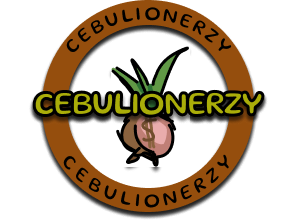
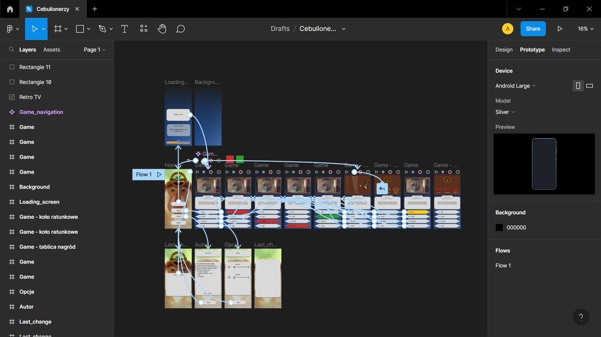
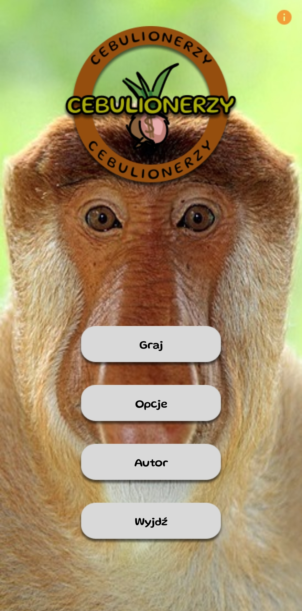
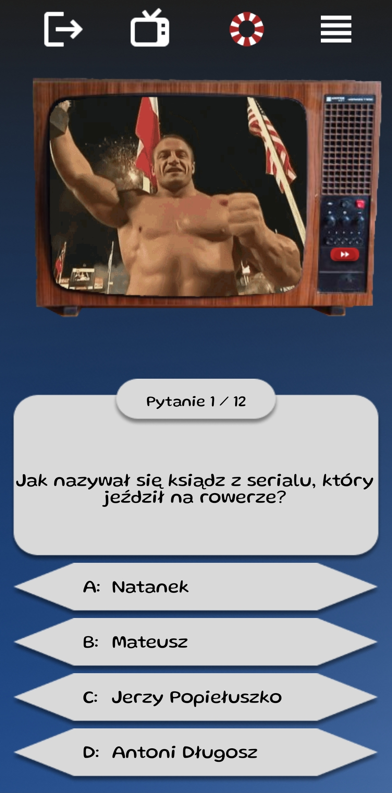
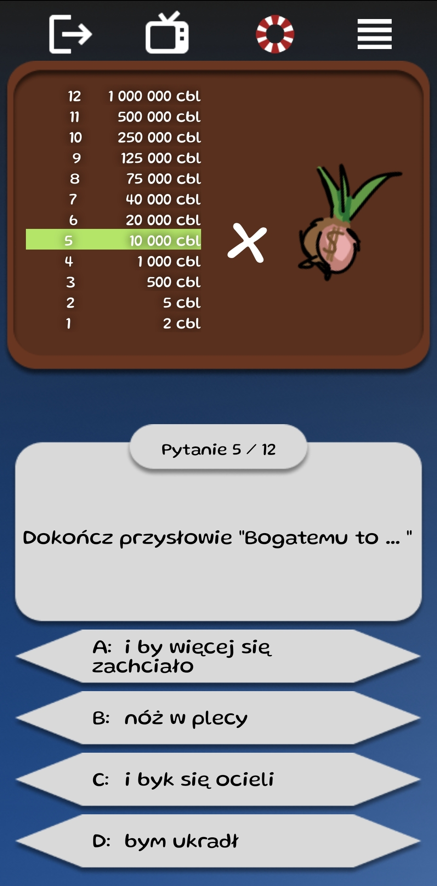

<p align="center">
  
</p>

<h1 align="center">
    🧅 <b>Project - "Cebulionerzy"</b> 🧅
</h1>

<p align="center">
  
  
  
  
  
  
  
</p>

---

## **Table of Contents** :clipboard:
- [Project description :scroll:](#project-description-scroll)
- [Features :video_game:](#features-video_game)
- [Technologies :hammer:](#technologies-hammer)
- [Conclusions :end:](#conclusions-end)
- [Getting started :rocket:](#getting-started-rocket)
- [Link to download the project :iphone:](#link-to-download-the-project-iphone)

# Project description :scroll:

As part of the credit for the optional course "Programming of mobile applications", I was tasked with making a mobile application/game for Android operating system. The main task was to use the knowledge gained during the class and create my own application. I designed and implemented a game based on the themes of the quiz TV show "Millionaire". I started with a prototype of the application, for which I used the Figma software. The Java programming language was used to implement the project. The questions that are displayed are taken from the Firebase Firestore Database. I tracked the entire project using the Git version control system. The graphics were made in GIMP, while the entire project was created in the Android Studio IDE.

Below you can see a prototype of the application made in Figma:

<p align="center">
  
</p>

Below you can see sample screenshots from my mobile app:

<p align="center">
  
   
  
</p>

# Features :video_game:

- 12 questions loaded from Firebase Firestore, with a top prize of 1 000 000 cebulions
- Three lifelines: Naród (audience vote chart), Połóweczka (50:50) and Telefon do Pjotera (phone a friend)
- Retro TV with switchable animated channels
- Award board showing the current progress
- Background music that can be turned off in the options
- Layouts that adapt to different phone screen sizes

# Technologies :hammer:

- Java
- Android Studio
- Firebase
- MPAndroidChart
- android-gif-drawable
- Git
- Figma
- GIMP

# Conclusions :end:

During the labs I had the opportunity to learn about the Android SDK and become familiar with elements such as Fragments and their life cycle, Intents or elements such as Toast, Dialog, Buttons, ListView, etc. The described project shows the use of this acquired knowledge.

# Getting started :rocket:

Requirements: Android Studio, Android SDK 32 and JDK 11 or 17 (the project uses Gradle 7.5, which does not run on newer JDKs).

```bash
git clone https://github.com/adrian-nafalski/Cebulionerzy.git
cd Cebulionerzy
./gradlew assembleDebug
```

You can also open the cloned folder in Android Studio. If the Gradle sync fails, select JDK 17 in *Settings > Build, Execution, Deployment > Build Tools > Gradle > Gradle JDK*.

# Link to download the project :iphone: 

- ["Cebulionerzy" project APK version available on Google Drive](https://drive.google.com/drive/folders/1d-L1hiP1Aa6qmBPbkaIymXbjjibWLMbz?usp=sharing)
